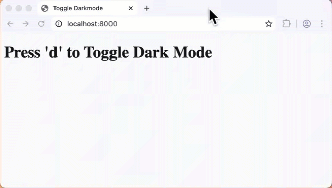

<div id="top"></div>

# Press 'd' to Toggle Dark Mode

**Objectives**

Toggle a **darkmode** class on the `<html>` element when the 'd' key is pressed.

Try it on this lesson page. Press **d** or use the button to switch between light and dark.

<button class="theme-toggle" id="theme-toggle" type="button">Toggle dark mode</button>

**Tools Needed**

You will need a [code editor](code-editors.html) and a web browser.

## Why Darkmode?

A light-on-dark color scheme uses light-colored text, icons, and elements on a dark background. Some people prefer dark mode and claim it reduces eye strain. Some people just think it's cool.

## Listening for Keystrokes

Events happen on a webpage. Our code can respond to them. For this project we will use the **keydown** event to toggle a class on the root element, `<html>`, when the 'd' key is pressed.

## HTML Setup

Create a working folder for this project named **darkmode**.

Create a basic html page with **script.js** and **style.css**.

Create a new file named `darkmode.html`.

```{.html .theme-example}
<!doctype html>
<html lang="en-US">
<head>
    <meta charset="utf-8">
    <meta name="viewport" content="width=device-width">
    <title>Toggle Dark Mode</title>
    <link rel="stylesheet" href="style.css">
    <script src="script.js" defer></script>
</head>
<body>
    <h1>Press 'd' to Toggle Dark Mode</h1>
</body>
</html>
```

### Add CSS

Put the colors and the default theme on `:root`, which selects the `<html>` element. The `darkmode` class switches the whole page to the dark colors. The `color-scheme` property also tells the browser how to style controls and scrollbars.

```{.css .theme-example}
:root {
    --dark-color: rgb(22, 22, 22);
    --light-color: rgb(249, 249, 249);
    color-scheme: light;
    background-color: var(--light-color);
    color: var(--dark-color);
}
:root.darkmode {
    color-scheme: dark;
    background-color: var(--dark-color);
    color: var(--light-color);
}
```

Your practice page starts in light mode. This lesson page starts with your system preference.

### JS

We are going to create a function named **toggleDarkMode()** that will listen for the **keydown** event and trigger the function.

Create the function:

```{.javascript .theme-example}
function toggleDarkMode(event) {
    if (event.key.toLowerCase() === 'd' && !event.repeat) {
        document.documentElement.classList.toggle('darkmode');
    }
}
```

`event.key` gives us the key that was pressed. `event.repeat` lets us skip repeated events when the key is held down. `document.documentElement` refers to `<html>`, so the class goes on the same element we styled with `:root`.

Add an event listener to the entire document.

```{.javascript .theme-example}
document.addEventListener("keydown", toggleDarkMode);
```

Open your practice page in a browser. Press **d** once to turn dark mode on, then press it again to return to light mode.

<video
  src="../imgs/web12-toggle.mp4"
  controls
  playsinline
  preload="metadata"
  width=400px>
  
</video>

## Conclusion

You used a keyboard event to toggle a class on the HTML element. CSS uses that class to switch the page colors, and `color-scheme` lets browser controls follow the chosen theme.

## Next steps

- What more can you do with keyboard interaction?
- How can you change the dark and light colors to something different?
- What if you wanted to press a button in addition to the keydown?
- Could you add different features for different keystrokes? Such as blanking the screen?
- Could a sequence of keystrokes reveal a hidden link?
- How could you use the `prefers-color-scheme` media query to follow the user's system preference?

<script>
function toggleLessonTheme() {
    const root = document.documentElement;
    const systemTheme = matchMedia('(prefers-color-scheme: dark)').matches ? 'dark' : 'light';
    const currentTheme = root.dataset.theme || systemTheme;
    root.dataset.theme = currentTheme === 'dark' ? 'light' : 'dark';
}

document.getElementById('theme-toggle').addEventListener('click', toggleLessonTheme);
document.addEventListener('keydown', (event) => {
    if (event.key.toLowerCase() === 'd' && !event.repeat && !event.metaKey && !event.ctrlKey && !event.altKey) {
        toggleLessonTheme();
    }
});
</script>

<p><a href="#top">Back to top.</a></p>
