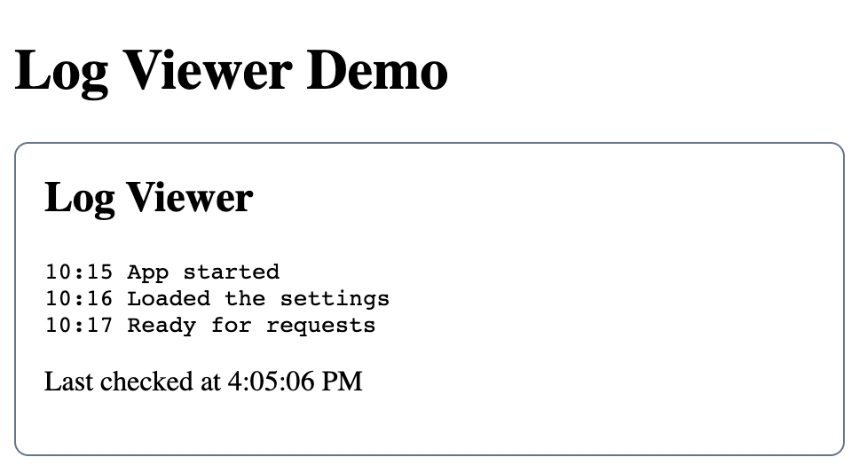

# WEB19 – Build Your First Web Component

Build a `<log-viewer>` element that shows the contents of a text file and checks for changes every five seconds. A **custom element** is an HTML tag whose behavior you define in JavaScript. You can use the tag more than once, and each copy gets its own display.

**Objectives**

- Register a custom HTML element with JavaScript.
- Use a template and shadow DOM to give each viewer its own markup and styles.
- Read a local text file with `fetch()` and check for changes on a timer.

You'll use familiar HTML, CSS, and JavaScript. If you've written a function and used `querySelector()` or `textContent`, you have enough JavaScript to start. The examples introduce classes and `fetch()` as you need them.

**Tools Needed**

- A [code editor](code-editors.html) and a web browser
- A local web server. Use your editor's server or run the server in Step 1 with Python 3 and a terminal.

## Step 1 – Set up the project

Create a folder called `web19-log-viewer` and open it in your [code editor](code-editors.html). Create these three files inside it. Keep them in the same folder.

```text
web19-log-viewer/
  index.html
  log-viewer.js
  log.txt
```

Paste this into **index.html**. The script tag at the bottom loads the JavaScript after the browser has read the `<log-viewer>` tag.

```html
<!doctype html>
<html lang="en">
<head>
  <meta charset="utf-8">
  <meta name="viewport" content="width=device-width, initial-scale=1">
  <title>Log Viewer Demo</title>
</head>
<body>
  <h1>Log Viewer Demo</h1>
  <log-viewer></log-viewer>
  <script src="log-viewer.js"></script>
</body>
</html>
```

Paste these sample lines into **log.txt** and save it as plain text.

```text
10:15 App started
10:16 Loaded the settings
10:17 Ready for requests
```

Open the project through a **local web server** so that `fetch()` can request `log.txt` over HTTP. If your editor already has a local server, use it to serve this folder. With Python 3, you can open a terminal in the project folder and run one of these commands.

**macOS or Linux**

```bash
python3 -m http.server 8000 --bind 127.0.0.1
```

**Windows**

```powershell
py -m http.server 8000 --bind 127.0.0.1
```

Leave the terminal running and open [http://127.0.0.1:8000/](http://127.0.0.1:8000/) in your browser. If port 8000 is in use, try 8001 in both the command and the address. Check that your browser address starts with `http://` or `https://`. Double-clicking the HTML file opens a `file://` address, where the browser can block the request for `log.txt`.

**Check your work.** You should see the **Log Viewer Demo** heading. The custom tag is still empty because `log-viewer.js` is empty.

## Step 2 – Register the custom element

Paste this into **log-viewer.js**, save it, and reload the page.

```javascript
class LogViewer extends HTMLElement {
  connectedCallback() {
    this.textContent = 'The log viewer is ready.';
  }
}

customElements.define('log-viewer', LogViewer);
```

- A **class** groups the code that describes an object. `extends HTMLElement` gives your class the features of a regular HTML element.
- `customElements.define()` tells the browser which class to use for the `<log-viewer>` tag. Use a lowercase name with a hyphen, and register it once.
- The browser calls `connectedCallback()` when the element connects to the page. Inside the method, `this` refers to the particular `<log-viewer>` being connected.

**Check your work.** Look for **The log viewer is ready.** below the heading. If the message is missing, make sure you saved the file and try a hard reload. If it still doesn't appear, check the Console in your browser's developer tools and confirm that the script filename and the custom tag match the code exactly.

## Step 3 – Give the component its own HTML and CSS

Replace **all** of **log-viewer.js** with this version. Keep this version for the rest of the lesson.

```javascript
const template = document.createElement('template');
template.innerHTML = `
  <style>
    :host {
      display: block;
      padding: 1rem;
      border: 1px solid #65758b;
      border-radius: 0.5rem;
    }

    h2 {
      margin-top: 0;
    }

    pre {
      white-space: pre-wrap;
      overflow-wrap: anywhere;
    }
  </style>

  <h2>Log Viewer</h2>
  <pre class="log-content">Waiting for log data…</pre>
  <p class="log-status">Status: Ready</p>
`;

class LogViewer extends HTMLElement {
  constructor() {
    super();
    this.attachShadow({ mode: 'open' });
    this.shadowRoot.append(template.content.cloneNode(true));
  }
}

customElements.define('log-viewer', LogViewer);
```

The backticks let you write the HTML and CSS across several lines. A `<template>` holds that markup until you use it. `template.content.cloneNode(true)` copies the whole template, including its nested elements, so each viewer gets its own copy.

The browser runs the **constructor** when it creates the custom element. `super()` sets up the built-in HTML element and must run before you use `this`. `attachShadow()` gives the element its own DOM tree, called the **shadow DOM**. The template's styles apply inside that tree, and `:host` styles the `<log-viewer>` tag itself. Page-level CSS selectors do not reach inside the shadow tree, though inherited styles such as fonts can carry through. With `mode: 'open'`, you can access the tree as `this.shadowRoot`.

**Check your work.** Save and reload. You should see a bordered box with **Log Viewer**, **Waiting for log data…**, and **Status: Ready**. Inspect `<log-viewer>` in your browser's developer tools and expand `#shadow-root` to see the copied markup.

## Step 4 – Load the text file once

In **log-viewer.js**, paste these two methods **inside** the `LogViewer` class, after the constructor and before the class's final closing brace. Leave `customElements.define()` below the class.

```javascript
  connectedCallback() {
    this.loadLog();
  }

  async loadLog() {
    const content = this.shadowRoot.querySelector('.log-content');
    const status = this.shadowRoot.querySelector('.log-status');

    try {
      const response = await fetch('log.txt', { cache: 'no-store' });
      if (!response.ok) {
        throw new Error(`HTTP ${response.status}`);
      }

      const text = await response.text();
      content.textContent = text || 'The log file is empty.';
      const time = new Date().toLocaleTimeString();
      status.textContent = `Last checked at ${time}`;
    } catch (error) {
      content.textContent = 'Could not load log.txt.';
      status.textContent = `Error: ${error.message}`;
    }
  }
```

1. `connectedCallback()` starts the first load. `this.shadowRoot.querySelector()` finds the two places in this viewer that need updating.
2. `async` lets this method use `await`. The first `await` waits for the server's response. The second waits for the body of that response as text. `cache: 'no-store'` asks the browser to skip its cached copy.
3. A missing file can return a response with an HTTP status of `404`. Check `response.ok` and throw an error if the status indicates failure. The `catch` block shows the problem in the viewer.
4. `textContent` displays the log as plain text, including any angle brackets. The `<pre>` element preserves line breaks.

**Check your work.** Save and reload. You should see the three log entries and **Last checked at** with the current time. If you get a `404`, open `log.txt` directly by changing the end of your browser address to `/log.txt` on the Python server. Check the folder and spelling, including whether the editor saved it as `log.txt.txt`.

## Step 5 – Check for changes every five seconds

Replace **only** the `connectedCallback()` method with the two methods below. Leave the constructor and `loadLog()` in place.

```javascript
  connectedCallback() {
    this.loadLog();
    this.intervalId = setInterval(() => this.loadLog(), 5000);
  }

  disconnectedCallback() {
    clearInterval(this.intervalId);
  }
```

`setInterval()` schedules the next check and gives you a timer ID. The browser calls `disconnectedCallback()` when the component leaves the page. Use the saved ID with `clearInterval()` to stop future checks.

A slow request can take longer than five seconds. To skip the next check while a request is still running, add these lines at the **start** of `loadLog()`, before the `querySelector()` lines.

```javascript
    if (this.loading) return;
    this.loading = true;
```

Then replace the `catch` block and its preceding brace with the lines below. The `finally` block runs after success or failure, so the next scheduled check can start a new request.

```javascript
    } catch (error) {
      content.textContent = 'Could not load log.txt.';
      status.textContent = `Error: ${error.message}`;
    } finally {
      this.loading = false;
    }
```

**Check your work.** Save `log-viewer.js` and reload once. With the browser tab open, add a line to **log.txt** and save it. Within about five seconds, the new line should appear on its own. If your editor reloads the page when you save, switch to the Python server for this check.

Here's the finished viewer with the original sample log.



## Test your finished viewer

1. **Missing file.** Rename `log.txt` to `log-backup.txt`. Wait for the viewer to show an error, then rename the file back. The log should reappear on the next successful check.
2. **Reuse.** Add a second `<log-viewer></log-viewer>` line in **index.html** before the script tag. Reload and check that both boxes display the log.
3. **Customize.** Change the border color in the template's `:host` rule. Reload and look for the new color on both boxes.

When you're done, stop the Python server by pressing **Ctrl+C** in the terminal where you started it.

## Conclusion

You turned `<log-viewer>` into a reusable HTML tag by registering a JavaScript class. Each viewer copies the same template into its own shadow DOM, so it has its own content and styles. You used `fetch()` to read a text file, refreshed it on a timer, and stopped the timer when the viewer left the page. Adding a second tag showed how you can reuse the whole component with one line of HTML.

## Further reading

- [Using custom elements](https://developer.mozilla.org/en-US/docs/Web/API/Web_components/Using_custom_elements)
- [Using shadow DOM](https://developer.mozilla.org/en-US/docs/Web/API/Web_components/Using_shadow_DOM)
- [Using the Fetch API](https://developer.mozilla.org/en-US/docs/Web/API/Fetch_API/Using_Fetch)
